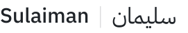

<picture>
  <source media="(prefers-color-scheme: dark)" srcset="https://raw.githubusercontent.com/SulaimanW/SulaimanW/main/assets/wordmark-dark.svg">
  
</picture>

Hi, I'm Sulaiman, a CS student in Jeddah. I like building things people actually use, from apps for real clients to AI agents that know when to say no. I also once spent a summer measuring exploding stars.

`building` **Raqeeb**: stops prompt-injected AI agents from misusing their tools\
`research` Research intern, University of Toronto, through KAUST Academy Stage 4 (1 of ~13 placed there, out of 18,000 applicants)\
`modeled `  a supernova's brightness over time\
`won     ` 1st place, Logistics Data Science Hackathon 2026 (Mawani.ai)\
`building` App for car service shops, built for a client\
`reach   ` [LinkedIn](https://linkedin.com/in/sulaiman-alangari) · [CV](https://github.com/SulaimanW/SulaimanW/blob/main/cv.pdf)
